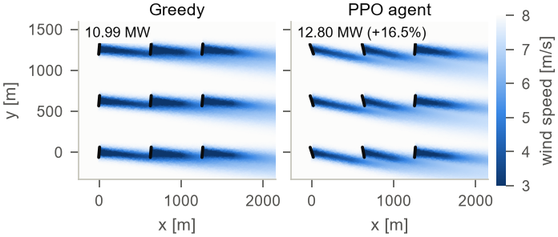

# WakeSteer — Reinforcement Learning for Wind-Farm Wake Steering

**AI Course Mini-Project, Assignment 2 — Real-Life Use Cases of Reinforcement Learning**
Team: _see the report header_ (`report/team.tex`) · Report: [`report/report.pdf`](report/report.pdf)

Wakes shed by upstream wind turbines cut the output of the machines behind them — by up to 75 % in the farm
studied here. *Wake steering* deliberately yaws upstream rotors a few degrees away from the wind so that their
wakes are deflected past the downstream turbines. This project formulates farm-level yaw control as a
**Markov decision process** and trains a **PPO agent** (implemented from scratch in PyTorch) inside NREL's
open-source **FLORIS** wake simulator. The agent observes the noisy measured wind speed and direction, its own
yaw offsets and every turbine's power output, and commands yaw-offset set-points to all nine turbines of a
3×3 NREL 5-MW farm. It is compared with **greedy control** (every turbine faces the wind — industry practice)
and with **model-based look-up tables** optimised offline by FLORIS itself, with and without measurement
filtering.



<!-- RESULTS -->

---

## RL formulation

| | |
|---|---|
| **Simulator** | FLORIS v4, Gauss–Curl-Hybrid wake model; 3×3 NREL 5-MW turbines, 5 D spacing, TI 6 % |
| **Time step / episode** | Δt = 60 s; 60 steps (one hour); time-limit truncation handled by bootstrapping |
| **Wind (exogenous)** | direction: persistent random walk θₜ₊₁ = θₜ + δₜ₊₁, δₜ₊₁ = 0.7 δₜ + 0.8°·ε; speed: Ornstein–Uhlenbeck process around an episode mean ~ U[5, 12] m/s; measurements carry 2° / 0.2 m/s noise |
| **State / observation** (22-D) | sin and cos of measured direction; normalised measured speed; last direction change; measured yaw offset of each turbine; power of each turbine / rated power (the true wind is hidden: a POMDP) |
| **Action** (9-D, continuous) | yaw-offset set-point per turbine, a ∈ [−1, 1] → ±25°; yaw drives move at ≤ 0.3°/s (18° per step) |
| **Reward** | 100·(P_farm − P_greedy(wind)) / P_capacity − 0.005·Σ\|nacelle travel in degrees\| |
| **Discount** | γ = 0.5, selected on validation weather from {0, 0.5, 0.8, 0.95} |

`P_greedy(wind)` is the power of the all-aligned farm in the same wind. The wind is exogenous, so this baseline
shifts every policy's return by the same amount — the optimal policy is unchanged, but the reward variance caused
by wind-speed fluctuations (power ∝ U³) disappears. The travel term prices yaw-drive wear and discourages
chattering. The objective that is reported is undiscounted energy; γ is a training hyper-parameter.

## Method highlights

* **Batched FLORIS environment** (`wakesteer/env.py`). A FLORIS call has ~20 ms of fixed overhead, so all 256
  training environments advance in lock-step with a single vectorised FLORIS evaluation per step, split across
  worker processes (~3.8k environment steps/s on an i7-12700H laptop). Passing the turbine definition as a dict
  avoids re-parsing YAML on every call (~25 % faster). A Gymnasium interface `WakeSteer-v0` is included.
* **PPO from scratch** (`wakesteer/ppo.py`): Gaussian policy, separate actor/critic MLPs (2×256, tanh), Fourier
  features of the wind direction, clipped surrogate, GAE(λ = 0.9), annealed learning rate, KL early stopping,
  per-network gradient clipping, bootstrapping at time-limit truncations, exploring starts.
* **Exact rotation symmetry.** FLORIS computes wakes in a wind-aligned frame, so for a layout invariant under
  90° rotation the farm at wind direction θ behaves exactly like the farm at θ − 90° with turbines relabelled
  (verified numerically to 1e-6). The actor-critic rotates every observation into one canonical 90° wind
  sector, permutes the turbine features, and permutes the yaw commands back: the policy is equivariant by
  construction and learns a quarter of the wind rose (≈3× faster learning than a plain MLP).
* **Discount-factor study.** Long-horizon returns are dominated by the random wind while the yaw drives reach
  any set-point within 1–3 steps, so short horizons learn faster and better; γ = 0.5 was best on validation.
* **Fair evaluation.** Held-out weather seeds (never used in training or checkpoint selection); every
  controller faces identical wind realisations, so all gains are paired comparisons.

## Baselines

* **Greedy** — zero yaw offsets; every turbine tracks the measured wind direction (standard practice).
* **LUT (FLORIS-SR)** — yaw offsets optimised offline with FLORIS' Serial-Refine method on a 1° × 1 m/s grid
  (3 960 optimisations) using the *same* wake model the agent is tested in, looked up at the measured wind
  (nearest direction bin, linear in speed): a model-based reference with perfect model knowledge.
* **LUT + filter** — the same LUT fed with exponentially smoothed wind measurements, the nacelles tracking the
  smoothed direction; the smoothing factor is tuned on the validation weather.
* **Random** — uniformly random set-points.

These are baselines only — the proposed controller is the RL agent.

## Repository layout

```
wakesteer/            Python package (all code written for this project)
  farm.py             FLORIS wrapper: farm layout, batched + multi-process power evaluation,
                      greedy-power reference table, rotation-symmetry detection
  wind.py             stochastic wind (persistent random-walk direction, OU speed, sensor noise)
  env.py              the MDP: vectorised lock-step env for training + Gymnasium env "WakeSteer-v0"
  ppo.py              PPO (clipped surrogate, GAE) with a C4-equivariant actor-critic
  lut.py              FLORIS Serial-Refine look-up-table baseline
  controllers.py      greedy / LUT / filtered LUT / random / trained-policy controllers
  evaluation.py       paired roll-outs, summaries, steady-state sweeps
  config.py           YAML experiment configs (with `base:` inheritance)
configs/              ppo.yaml (main agent), gamma_*.yaml (discount study), ablation_*.yaml
scripts/              build_lut.py, train.py, evaluate.py, make_figures.py, report_numbers.py, demo.py
runs/<run>/           trained agents: policy.pt (best validation), policy_final.pt, progress.csv
                      (learning curve) and config.yaml (exact settings of that run)
artifacts/            cached FLORIS tables (greedy reference, optimal-yaw LUT)
results/              evaluation.json, results_table.md, figures/ (PDF + PNG)
report/               two-column LaTeX report (report.tex -> report.pdf); team.tex holds the header
tests/                pytest unit tests (environment dynamics, GAE, symmetry, LUTs, I/O)
```

## Installation

Requires Python 3.10–3.13 (developed with 3.13 on Windows 11). A CPU is enough; no GPU is used.

```bash
git clone <this-repository-url> WakeSteer
cd WakeSteer
python -m venv .venv
# Windows: .venv\Scripts\activate      Linux/macOS: source .venv/bin/activate
pip install -r requirements.txt
python -m pytest -q                     # 16 tests, ~20 s
```

Dependencies: `floris==4.7`, `gymnasium`, `numpy`, `torch`, `matplotlib`, `pyyaml`, `pandas`, `pytest`.
The setup above was verified in a fresh virtual environment (PyTorch 2.14 CPU, pandas 3.1); the agents were
trained with PyTorch 2.6. On Windows, keep the repository path short (PyTorch contains deeply nested files
that can exceed the 260-character path limit) or enable long paths.

## Quick start — run the trained agent

```bash
python scripts/demo.py                  # trained PPO vs greedy vs LUT on 32 unseen one-hour episodes (~1 min)
```

The main agents are `runs/ppo_seed{0,1,2}/policy.pt`; the discount study and ablations are in
`runs/gamma_*` and `runs/ablation_*`. Load an agent in your own code:

```python
from wakesteer.ppo import load_policy
from wakesteer.env import WakeSteeringVecEnv
model, payload = load_policy("runs/ppo_seed0/policy.pt")
env = WakeSteeringVecEnv(n_envs=4)
obs = env.reset(seed=0)
obs, reward, done, info = env.step(model.act(obs))     # yaw set-points for all 9 turbines
```

The environment also follows the standard Gymnasium API:

```python
import gymnasium as gym, wakesteer.env
env = gym.make("WakeSteer-v0")
obs, info = env.reset(seed=0)
obs, reward, terminated, truncated, info = env.step(env.action_space.sample())
```

## Reproducing every result

All commands run from the repository root; times are for an Intel i7-12700H laptop. `--set key=value`
overrides any config entry (e.g. `--set n_workers=4`), `--resume` continues an interrupted run.

```bash
# 1. FLORIS tables: greedy reference (~10 s) and Serial-Refine optimal-yaw LUT (~75 s on 8 cores)
python scripts/build_lut.py

# 2. Main agent (gamma = 0.5), three seeds, 3M steps each (~40-60 min per run)
python scripts/train.py --config configs/ppo.yaml --seed 0
python scripts/train.py --config configs/ppo.yaml --seed 1
python scripts/train.py --config configs/ppo.yaml --seed 2

# 3. Discount-factor study (gamma = 0.5 is the main agent above)
python scripts/train.py --config configs/gamma_0.0.yaml --seed 0
python scripts/train.py --config configs/gamma_0.8.yaml --seed 0
python scripts/train.py --config configs/gamma_0.95.yaml --seed 0    # also seeds 1, 2 (stopped at 3.6M steps)

# 4. Ablations (one seed each)
python scripts/train.py --config configs/ablation_no_symmetry.yaml --seed 0   # plain MLP, gamma = 0.95, 5M steps
python scripts/train.py --config configs/ablation_no_powers.yaml   --seed 0
python scripts/train.py --config configs/ablation_no_yaw_cost.yaml --seed 0

# 5. Held-out evaluation, robustness studies, figures and report numbers
python scripts/evaluate.py              # ~10 min -> results/evaluation.json
python scripts/make_figures.py          # -> results/figures/ and report/figures/
python scripts/report_numbers.py        # -> report/numbers.tex, report/table_main.tex, results/results_table.md

# 6. Report (any LaTeX distribution, or upload the report/ folder to Overleaf)
cd report && pdflatex report.tex && pdflatex report.tex
```

The three γ = 0.95 seeds were launched with a 5M-step budget and stopped at 3.6M steps, after their validation
reward had been flat for more than 1.5M steps; their `policy_final.pt` is the last checkpoint.

## References

1. NREL. *FLORIS v4.* https://github.com/NREL/floris
2. J. Schulman et al. *Proximal Policy Optimization Algorithms.* arXiv:1707.06347, 2017.
3. J. Schulman et al. *High-Dimensional Continuous Control Using Generalized Advantage Estimation.* ICLR 2016.
4. P. Fleming et al. *Serial-Refine Method for Fast Wake-Steering Yaw Optimization.* J. Phys.: Conf. Ser. 2265, 2022.
5. J. King et al. *Control-oriented model for secondary effects of wake steering.* Wind Energy Science 6, 2021.
6. J. Jonkman et al. *Definition of a 5-MW Reference Wind Turbine for Offshore System Development.* NREL/TP-500-38060, 2009.

All code in this repository was written for this project; FLORIS, PyTorch, Gymnasium, NumPy and Matplotlib are
used as libraries.
